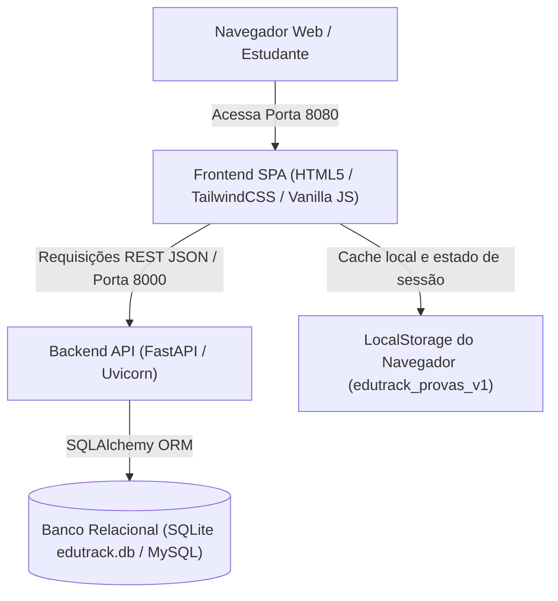
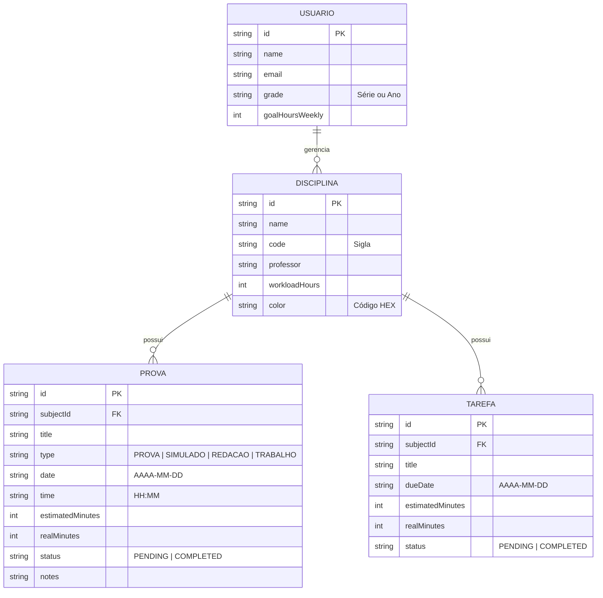

# Documento de Especificação Técnica e de Negócio
# **EduTrack Provas — MVP**
*Sistema de Gestão de Estudos, Cronogramas de Avaliações e Controle de Prazos Acadêmicos*

---

## Sumário
1. [Visão Geral e Proposta de Valor](#1-visão-geral-e-proposta-de-valor)
2. [Público-Alvo e Casos de Uso Principais](#2-público-alvo-e-casos-de-uso-principais)
3. [Diretrizes de Design e UX/UI](#3-diretrizes-de-design-e-uxui)
4. [Arquitetura Geral do Sistema](#4-arquitetura-geral-do-sistema)
5. [Modelo e Dicionário de Dados](#5-modelo-e-dicionário-de-dados)
6. [Módulos e Regras de Negócio](#6-módulos-e-regras-de-negócio)
7. [Especificação Completa das APIs REST (Backend)](#7-especificação-completa-das-apis-rest-backend)
8. [Estrutura Física de Diretórios e Arquivos](#8-estrutura-física-de-diretórios-e-arquivos)
9. [Segurança, Resiliência e Tratamento de Erros](#9-segurança-resiliência-e-tratamento-de-erros)
10. [Instruções de Inicialização e Execução](#10-instruções-de-inicialização-e-execução)
11. [Histórico Completo de Interações e Evolução (Programador & Antigravity)](#11-histórico-completo-de-interações-e-evolução-programador--antigravity)

---

## 1. Visão Geral e Proposta de Valor

### 1.1 Objetivo
O **EduTrack Provas** é uma solução de software voltada para simplificar a vida acadêmica do estudante. O objetivo é fornecer uma visão clara, imediata e centralizada de **quando ocorrem as provas, quais são as tarefas pendentes e qual é o progresso real de entregas**.

### 1.2 O Diferencial: Foco em Entregas (Sem Cálculo de Notas)
Diferente dos sistemas acadêmicos tradicionais que sobrecarregam o estudante com médias ponderadas, notas parciais, fórmulas de recuperação e metas de aprovação numérica, o EduTrack adota o princípio de **Produtividade por Conclusão**:
- O foco é a realização das atividades no prazo.
- Eliminação deliberada de notas, pesos e médias.
- Menos ansiedade por notas e maior foco no ritmo de estudo e presença nas datas críticas.

---

## 2. Público-Alvo e Casos de Uso Principais

### 2.1 Público-Alvo
- Estudantes do Ensino Médio.
- Vestibulandos (ENEM, Fuvest, Unicamp, etc.).
- Estudantes de graduação e pós-graduação.
- Concurseiros com cronograma fixo de provas e simulados.

### 2.2 Casos de Uso Principais (User Stories)
1. **Cadastrar e Visualizar Avaliações**: O aluno cadastra uma prova com data, horário, duração estimada e anotações, visualizando imediatamente os dias restantes no painel.
2. **Organizar por Disciplina**: Cadastrar matérias com cores personalizadas, professor e carga horária para categorizar exames e tarefas.
3. **Marcar Conclusão**: Ao finalizar uma avaliação ou tarefa, o estudante marca como concluída e pode registrar o tempo real gasto.
4. **Gerenciar Conta com Facilidade**: Cadastrar usuário, fazer login com persistência no banco SQL, redefinir senha esquecida ou deletar conta diretamente da tela inicial.

---

## 3. Diretrizes de Design e UX/UI

- **Estilo Visual**: *Bento Grid Moderno*, com cantos arredondados (`rounded-2xl` / `rounded-3xl`), sombras suaves e bordas elegantes em modo escuro.
- **Paleta de Cores**:
  - **Primária**: Verde Esmeralda (`#10b981` / `#059669`).
  - **Secundária / Acentos**: Ciano (`#06b6d4`), Âmbar (`#f59e0b`) e Coral (`#f43f5e`).
  - **Fundo**: Superfícies escuras Obsidian/Slate (`#090d16` e `#0f172a`), garantindo alto contraste e conforto visual.
- **Identidade Limpa**:
  - Sem seletores de cores de tema espalhados.
  - Sem alternância de tema claro/escuro (modo escuro permanente e otimizado).
  - Sem ruído visual de cronômetros invasivos (Pomodoro) ou alertas fictícios de IA.
- **Responsividade Total**: Layout adaptável para telas grandes (Desktop), tablets e smartphones (com menu lateral recolhível e backdrop).

---

## 4. Arquitetura Geral do Sistema

O sistema foi arquitetado em **duas camadas desacopladas** (Frontend SPA + Backend RESTful API), com persistência híbrida:



---

## 5. Modelo e Dicionário de Dados

### 5.1 Tabela `usuarios` (Banco de Dados Relacional SQL)
Persistida no banco `edutrack.db` via **SQLAlchemy**:

| Campo | Tipo no Banco | Chave | Nulo? | Descrição / Regra de Negócio |
| :--- | :--- | :---: | :---: | :--- |
| **`id`** | `INTEGER` | **PK** | NOT NULL | Identificador único numérico, autoincrementado. |
| **`nome`** | `VARCHAR(100)` | - | NOT NULL | Nome completo do estudante. |
| **`email`** | `VARCHAR(100)` | **UNIQUE** | NOT NULL | E-mail de acesso (único no sistema, índice criado). |
| **`senha`** | `VARCHAR(255)` | - | NOT NULL | Senha de autenticação do usuário. |
| **`data_criacao`** | `DATETIME` | - | NOT NULL | Registro temporal gerado automaticamente via `datetime.utcnow`. |

### 5.2 Estrutura Relacional Acadêmica (Frontend / JSON Local)



---

## 6. Módulos e Regras de Negócio

### 6.1 Módulo: Autenticação e Gestão de Conta
1. **Entrar (Login)**:
   - Valida credenciais via `POST /auth/login`.
   - Armazena usuário ativo na sessão e redireciona ao painel geral.
2. **Cadastrar**:
   - Cria o usuário via `POST /usuarios/`.
   - Verifica duplicidade de e-mail e emite toast amigável.
3. **Esqueci Minha Senha**:
   - Disponível em link contextual acima do campo de senha e no rodapé do card.
   - Envia e-mail e nova senha para `POST /auth/esqueci-senha`.
   - Atualiza o banco e preenche a tela de login automaticamente.
4. **Deletar Conta**:
   - Modal com alerta vermelho de confirmação de segurança.
   - Exige e-mail e senha para exclusão via `POST /auth/deletar-conta`.
   - Limpa sessão e desloga o estudante.
5. **Acesso Convidado**:
   - Permite testar todas as funcionalidades imediatamente sem cadastro prévio.

### 6.2 Módulo: Painel "Geral" (Bento Dashboard)
- **Hero Banner**: Saudação contextual e botões de atalho rápido (*Nova Matéria* e *Nova Prova*).
- **Cards de Métricas Principais**:
  - *Próxima Avaliação*: Exibe título da prova mais próxima, disciplina, horário e badge de urgência calculado em dias:
    - `Hoje!` ou `Amanhã!` (Alerta Âmbar/Vermelho).
    - `Em X dias` (Acompanhamento normal).
    - `Tudo em dia` (Caso não haja pendências).
  - *Progresso de Entregas*: Porcentagem global de conclusão de provas e tarefas combinadas.
  - *Entregas Concluídas Total*: Total realizado vs total cadastrado (ex: `8 / 12`).
- **Radar de Provas & Prazos**: Lista das 4 avaliações mais urgentes com acesso a detalhes com um clique.
- **Resumo das Disciplinas**: Grid com status visual de cada matéria (*Em Dia*, *Em Andamento* ou *A Iniciar*).

### 6.3 Módulo: Provas & Avaliações
- **Cadastro & Edição (`modalExam`)**:
  - Seleção de disciplina existente.
  - Título, tipo de exame, data, horário, duração estimada (minutos) e conteúdo programático/anotações.
- **Filtros Dinâmicos**:
  - Filtro por Disciplina (Todas ou específica).
  - Filtro por Status (Pendentes / Concluídas).
  - Filtro por Tipo (Prova, Simulado, Redação, Trabalho).
- **Conclusão (`modalCompleteExam`)**:
  - Permite marcar como concluída informando o tempo real despendido.
- **Ações**: Visualizar detalhes, reabrir avaliação concluída, editar dados ou excluir.

### 6.4 Módulo: Minhas Disciplinas
- **Cadastro (`modalSubject`)**:
  - Nome da disciplina, código/sigla, professor(a), carga horária (horas) e paleta seletora de cor.
- **Visão Detalhada (`modalSubjectDetails`)**:
  - Exibe resumo da disciplina e lista todas as provas e atividades vinculadas a ela com status.
  - Opção para excluir a disciplina (remove em cascata as provas vinculadas).

### 6.5 Módulo: Tarefas de Estudo
- Gerenciamento rápido de listas de exercícios, revisões e leituras.
- Checkbox instantâneo para marcar como concluída/pendente.
- Cálculo automático na barra de progresso do painel geral.

---

## 7. Especificação Completa das APIs REST (Backend)

- **Tecnologia**: FastAPI (Python 3.12+), SQLAlchemy 2.x, Pydantic v2, Uvicorn.
- **Base URL**: `http://127.0.0.1:8000`
- **Swagger UI**: `http://127.0.0.1:8000/docs`
- **ReDoc**: `http://127.0.0.1:8000/redoc`

| Método | Endpoint | Descrição | Request Body | Status Sucesso | Possíveis Erros |
| :--- | :--- | :--- | :--- | :---: | :--- |
| `GET` | `/` | Health check da API | Nenhum | `200 OK` | - |
| `POST` | `/usuarios/` | Cadastro de usuário | `{"nome", "email", "senha"}` | `201 Created` | `400` (E-mail duplicado) |
| `POST` | `/auth/login` | Login com autenticação | `{"email", "senha"}` | `200 OK` | `401` (Credenciais inválidas) |
| `POST` | `/auth/esqueci-senha` | Redefinição de senha | `{"email", "nova_senha"}` | `200 OK` | `404` (E-mail não encontrado) |
| `POST` | `/auth/deletar-conta` | Exclusão de conta por credenciais | `{"email", "senha"}` | `200 OK` | `401` (Credenciais inválidas) |
| `GET` | `/usuarios/` | Listagem geral de usuários | Nenhum | `200 OK` | - |
| `GET` | `/usuarios/{id}` | Busca de usuário por ID | Nenhum | `200 OK` | `404` (Usuário não existe) |
| `PUT` | `/usuarios/{id}` | Atualização parcial ou total | `{"nome"?, "email"?, "senha"?}` | `200 OK` | `404` ou `400` (E-mail em uso) |
| `DELETE` | `/usuarios/{id}` | Exclusão de usuário por ID | Nenhum | `200 OK` | `404` (Não encontrado) |

---

## 8. Estrutura Física de Diretórios e Arquivos

O projeto está estritamente estruturado separando frontend e backend:

```text
edutrack-mvp/
│
├── frontend/                     # Interface do Usuário (Cliente Web SPA)
│   ├── index.html                # Marcação semântica HTML5, modais e layouts
│   ├── styles.css                # Design system, glassmorphism e animações
│   └── app.js                    # Lógica da aplicação, cálculos, renderização e chamadas à API
│
├── backend/                      # API RESTful e Persistência
│   ├── main.py                   # Servidor FastAPI, schemas Pydantic e rotas ORM
│   └── edutrack.db               # Banco de dados relacional SQLite local
│
├── iniciar.bat                   # Script executável do Windows (1 clique para subir ambos)
├── start.ps1                     # Script para PowerShell (inicialização paralela)
└── ESPECIFICACAO.md              # Documentação técnica e de negócio completa (este arquivo)
```

---

## 9. Segurança, Resiliência e Tratamento de Erros

1. **CORS Habilitado**: Configurado com `CORSMiddleware` no FastAPI para aceitar requisições do frontend local (`localhost:8080`).
2. **Fallback Offline Gracioso**: Se o backend estiver fora do ar no momento do login, o frontend detecta a indisponibilidade de rede e permite o acesso imediato em modo offline/convidado, sem travar a experiência do usuário.
3. **Persistência Concorrente**: O SQLite opera com `check_same_thread=False` para garantir compatibilidade com as rotas assíncronas do FastAPI.
4. **Banco Configurável via Ambiente**: A variável `DATABASE_URL` permite chavear facilmente para MySQL ou PostgreSQL sem alterar uma única linha de código.

---

## 10. Instruções de Inicialização e Execução

### Opção 1: Via Duplo Clique (Recomendado no Windows)
Dê um duplo clique no arquivo [`iniciar.bat`](file:///C:/Users/fconn/.gemini/antigravity/scratch/edutrack-mvp/iniciar.bat). Ele abrirá automaticamente o terminal do backend e o do frontend.

### Opção 2: Via Terminal Manual (Git Bash / PowerShell)

1. **Iniciar o Backend**:
   ```bash
   cd backend
   python -m uvicorn main:app --host 127.0.0.1 --port 8000 --reload
   ```

2. **Iniciar o Frontend**:
   ```bash
   python -m http.server 8080 --directory frontend
   ```

3. **URLs de Acesso**:
   - 💻 **Aplicação Web (Frontend)**: [http://localhost:8080](http://localhost:8080)
   - 📑 **Swagger API Docs (Backend)**: [http://127.0.0.1:8000/docs](http://127.0.0.1:8000/docs)

---

## 11. Histórico Completo de Interações e Evolução (Programador & Antigravity)

Esta seção documenta a cronologia exata de todas as solicitações do Programador e as soluções arquitetadas e implementadas pelo Antigravity, servindo como registro vivo de evolução contínua do projeto.

```
Regra de Manutenção Contínua:
Sempre que uma nova alteração, recurso ou refatoração for realizada no projeto EduTrack,
este documento e esta seção devem ser imediatamente atualizados com o registro das mudanças.
```

### 🗓️ Marco 1: Criação Inicial do MVP Inspirado no EduTrack
- **Solicitação do Usuário**: Criar um MVP com a ideia do site `edutrackprovas.netlify.app`, porém com design e cores diferentes (Bento Grid moderno) e preparar ambiente para rodar.
- **Implementação do Antigravity**:
  - Criado o projeto em `scratch/edutrack-mvp` com `index.html`, `styles.css` e `app.js`.
  - Implementado layout responsivo Bento Grid em verde esmeralda e tons escuros.
  - Criado dashboard com contagem regressiva de exames, radar de provas e listas de matérias.
  - Servidor local HTTP configurado na porta `8080`.

---

### 🗓️ Marco 2: Simplificação da Tela de Autenticação
- **Solicitação do Usuário**: *"Mudar a tela de login e cadastro do projeto. Tire essa imagem do lado e os ícones e deixe mais simples."*
- **Implementação do Antigravity**:
  - Removida a coluna lateral com ilustrações/imagens decorativas.
  - Criado card de autenticação centralizado, minimalista e limpo.
  - Eliminados ícones decorativos dentro dos campos de input, deixando campos de texto diretos e com foco rápido.

---

### 🗓️ Marco 3: Remoção de Seletor de Cores de Tema, Temporizador e Insights IA
- **Solicitação do Usuário**: *"Agora tirar a cor do tema, tirar temporizador e insights da IA."*
- **Implementação do Antigravity**:
  - Removido o seletor de paletas de cores da barra lateral (bolinhas de cores).
  - Removida a aba do Pomodoro / Temporizador e os contadores agressivos de tempo.
  - Removida a aba de Insights da IA / Copilot pedagógico.
  - Substituído o card do temporizador no dashboard pelo card de **Entregas Concluídas Total**.

---

### 🗓️ Marco 4: Remoção Total do Conceito de Notas e Médias
- **Solicitação do Usuário**: *"Tire a ideia de nota do aluno. Eu não quero."*
- **Implementação do Antigravity**:
  - Removidos todos os campos de notas (`grade`), pesos (`weight`) e metas de média (`targetGrade`).
  - No modal de cadastro de provas (`modalExam`), removido o campo "Peso na Média".
  - No modal de conclusão (`modalCompleteExam`), o título virou "Registrar Conclusão", solicitando apenas tempo real gasto (minutos), sem pedir nota.
  - Nas disciplinas, o indicador de nota foi substituído pela taxa percentual de entregas realizadas (`X/Y feitas`).
  - O sistema passou a ser 100% focado em cumprimento de datas, prazos e entregas.

---

### 🗓️ Marco 5: Renomeação da Aba do Painel
- **Solicitação do Usuário**: *"Mude o título Painel Bento para Geral."*
- **Implementação do Antigravity**:
  - A aba principal na barra lateral foi renomeada de **Painel Bento** para **Geral**.

---

### 🗓️ Marco 6: Remoção dos Modos Claro e Escuro
- **Solicitação do Usuário**: *"Tire o modo escuro e o modo claro."*
- **Implementação do Antigravity**:
  - Removido o botão de alternância Claro/Escuro do rodapé da barra lateral.
  - Travado o design no tema escuro padrão (Dark Mode permanente), garantindo consistência visual e sem flashes de troca de tema.

---

### 🗓️ Marco 7: Criação do Backend FastAPI com Banco de Dados Relacional
- **Solicitação do Usuário**: *"Jogar isso tudo no projeto aí: Dicionário de Dados de Usuários + código FastAPI / SQLAlchemy com rotas CRUD."*
- **Implementação do Antigravity**:
  - Criado o arquivo `main.py` com FastAPI, Pydantic e SQLAlchemy ORM.
  - Criada a tabela relacional `usuarios` com os campos: `id` (PK), `nome`, `email` (Unique), `senha`, `data_criacao`.
  - Configurado suporte a SQLite local (`edutrack.db`) e chaveamento transparente para MySQL via variável `DATABASE_URL`.
  - Implementadas as rotas `POST /usuarios/`, `POST /auth/login`, `GET /usuarios/`, `GET /usuarios/{id}`, `PUT /usuarios/{id}` e `DELETE /usuarios/{id}`.
  - Integrado o formulário de login e cadastro do `app.js` diretamente com a API FastAPI (`http://127.0.0.1:8000`).
  - Criados os utilitários de inicialização rápida `iniciar.bat` e `start.ps1`.

---

### 🗓️ Marco 8: Esqueci Minha Senha e Deletar Conta na Tela de Login
- **Solicitação do Usuário**: *"Colocar esquecer senha na tela de login e colocar deletar conta tudo isso na tela de login."*
- **Implementação do Antigravity**:
  - Criados os endpoints no backend:
    - `POST /auth/esqueci-senha`: busca o usuário pelo e-mail e atualiza a senha.
    - `POST /auth/deletar-conta`: valida e-mail e senha e remove a conta permanentemente do banco de dados.
  - No frontend (`index.html`):
    - Adicionado link rápido *"Esqueci minha senha"* estrategicamente posicionado acima do campo de senha.
    - Adicionado botão *"Deletar conta"* no rodapé do formulário.
    - Criados modais dedicados: `modalEsqueciSenha` e `modalDeletarConta` com validações completas e feedback visual via toasts.

---

### 🗓️ Marco 9: Suporte a Execução via Git Bash
- **Solicitação do Usuário**: *"Vou começar a rodar o site pelo git bash, então vc poderia me passar os comandos para ativar o servidores?"*
- **Implementação do Antigravity**:
  - Fornecidos comandos compatíveis com o terminal Git Bash (`cd "/c/Users/..."`, execução do Uvicorn e HTTP Server na porta 8080 em abas separadas ou com `&` em background).

---

### 🗓️ Marco 10: Separação Arquitetural das Pastas (Frontend e Backend)
- **Solicitação do Usuário**: *"Reorganizar a estrutura de pastas do projeto, pois atualmente todos os arquivos estão misturados na raiz. Separar o Frontend do Backend."*
- **Implementação do Antigravity**:
  - Criada a pasta `frontend/` contendo `index.html`, `styles.css` e `app.js`.
  - Criada a pasta `backend/` contendo `main.py` e `edutrack.db`.
  - Atualizados os scripts `iniciar.bat` e `start.ps1` para apontar `http.server --directory frontend` e `cd backend && python -m uvicorn main:app`.
  - Testados e validados ambos os serviços funcionando perfeitamente de forma isolada.

---

### 🗓️ Marco 11: Criação da Pasta `docs/` e Integração do Histórico
- **Solicitação do Usuário**: *"Criar um arquivo e jogar na pasta. Nessa especificação também tem que ter toda a nossa conversa entre programador e Antigravity para chegarmos até o resultado atual, e sempre que fizermos alguma alteração, atualizar essa especificação."*
- **Implementação do Antigravity**:
  - Criada a pasta `docs/` no projeto contendo `docs/ESPECIFICACAO.md`.
  - Incorporada esta Seção 11 com o histórico cronológico completo de tomadas de decisão, refinamentos e arquitetura.
  - Estabelecida a diretriz de atualização mandatória da documentação a cada novo ciclo de desenvolvimento.
  - Removida duplicidade do arquivo mantendo exclusivamente `docs/ESPECIFICACAO.md`.

---

### 🗓️ Marco 12: Ajustes de UI/UX no Login e Fluxo de Recuperação em 3 Etapas
- **Solicitação do Usuário**: *"Correção de duplicidade na tela de Login (remover link do rodapé e manter apenas o acima do input de Senha) e refatoração do modal Esqueci Minha Senha em 3 etapas sequenciais (Etapa 1: E-mail + Enviar Código; Etapa 2: Código de Verificação + Validar; Etapa 3: Nova Senha + Alterar Senha)."*
- **Implementação do Antigravity**:
  - **Limpeza no Login**: Removido o link duplicado do rodapé, mantendo apenas o link discreto posicionado elegantemente no cabeçalho do campo de senha (`index.html`). O botão *"Deletar conta"* foi alinhado à direita no rodapé.
  - **Refatoração do Modal (`modalEsqueciSenha`)**:
    - Adicionado indicador visual de progresso com 3 barras interativas.
    - **Etapa 1**: Campo exclusivo de e-mail e botão *"Enviar Código"*.
    - **Etapa 2**: Campo centralizado de código de verificação (6 dígitos), botão de retorno (*"← Voltar"*) e botão *"Validar"*.
    - **Etapa 3**: Campos de nova senha e confirmação de senha com botão *"Alterar Senha"*.
  - **Lógica e Transições (`app.js`)**:
    - Implementada a função `setResetPasswordStep(step)` para alternar a visibilidade com classes Tailwind (`hidden`).
    - Handlers dedicados `handleResetStep1Submit`, `handleResetStep2Submit` e `handleResetStep3Submit`.
    - Ao concluir com sucesso a Etapa 3, a nova senha é enviada para o backend (`/auth/esqueci-senha`), a tela de login é preenchida automaticamente e o modal é fechado.

---

### 🗓️ Marco 13: Redesign Moderno Split-Screen da Tela de Login (50/50)
- **Solicitação do Usuário**: *"Refatorar a interface da tela de Login do 'EduTrack Provas'. Adotar um layout split-screen (duas colunas 50/50) com fundo escuro Slate/Obsidian, paleta estrita Verde Esmeralda/Jade (sem azul), lado esquerdo com gradiente esmeralda e bolhas 3D em CSS puro com título e mensagem motivacional, e lado direito com card clean contrastante (fundo branco, inputs cinza sem bordas, ícones de usuário e cadeado, botões e links nas cores do tema, e todos os IDs preservados)."*
- **Implementação do Antigravity**:
  - **Estrutura Split-Screen (`index.html`)**:
    - Container de tela cheia com fundo Slate/Obsidian (`bg-[#090d16]`).
    - Card central ampliado (`max-w-4xl`), com cantos arredondados (`rounded-3xl`), sombra profunda (`shadow-2xl`) e divisão 50/50 em telas médias e superiores (`grid grid-cols-1 md:grid-cols-2`).
  - **Painel Decorativo Esquerdo**:
    - Fundo em gradiente suave Esmeralda/Teal (`from-emerald-600 via-emerald-700 to-teal-900`).
    - Bolhas e esferas 3D construídas exclusivamente em CSS puro com diferentes gradientes, opacidades, bordas translúcidas e efeito de profundidade (`blur-xl`, `shadow-inner`).
    - Badge superior com ícone do EduTrack, título em destaque e subtítulo motivacional com micro-rodapé decorativo.
  - **Painel de Formulário Direito**:
    - Fundo branco limpo (`bg-white`) oferecendo alto contraste e legibilidade.
    - Campos de entrada de E-mail e Senha remodelados com fundo cinza suave (`bg-gray-100`), sem bordas, cantos arredondados (`rounded-xl`) e ícones de usuário (`ph-user`) e cadeado (`ph-lock-key`).
    - Botão principal *"Entrar"* destacado em Verde Esmeralda (`bg-emerald-600 hover:bg-emerald-500`).
    - Link *"Esqueci minha senha"* em verde esmeralda com transição e sublinhado ao passar o cursor.
    - Botão secundário *"Acessar como Convidado"* com fundo transparente e borda cinza.
    - Link *"Deletar conta"* em vermelho no rodapé.
  - **Preservação Integral da Lógica e Integração**:
    - Todos os seletores e IDs necessários mantidos intactos (`authScreen`, `authForm`, `authHeading`, `authSubheading`, `tabAuthLogin`, `tabAuthRegister`, `authFieldNameGroup`, `authInputName`, `authInputEmail`, `authInputPassword`, `authSubmitBtn`, `modalEsqueciSenha`, `modalDeletarConta`), garantindo funcionamento instantâneo com `app.js` e a API FastAPI.

---

### 🗓️ Marco 14: Reescrita Completa do Container de Login (Flex Split-Screen e Correção de Sessão)
- **Solicitação do Usuário**: *"APAGUE o card de login antigo e REESCREVA a seção inteira do zero com Tailwind CSS: Container principal amplo com `flex flex-col md:flex-row`, `bg-white`, `rounded-3xl` e `shadow-2xl`. Lado esquerdo (50% desktop) com `bg-emerald-600`, `overflow-hidden`, 3 a 4 divs absolutas circulares (`rounded-full`) em tons de verde, título 'EduTrack Provas' e texto de boas-vindas. Lado direito (50% desktop) com fundo branco, inputs cinza (`bg-gray-100`) sem borda escura, botão 'Entrar' em verde (`bg-emerald-500`), link 'Esqueci minha senha', botão 'Acessar como Convidado' e manutenção estrita dos IDs para não quebrar o `app.js`."*
- **Implementação do Antigravity**:
  - **Reescrita Integral do HTML (`index.html`)**:
    - O card antigo foi completamente substituído pelo novo container `flex flex-col md:flex-row`, `w-full max-w-4xl lg:max-w-5xl min-h-[580px] bg-white rounded-3xl shadow-2xl overflow-hidden border border-slate-800/20`.
    - **Lado Esquerdo (50%)**: `w-full md:w-1/2 bg-emerald-600 relative overflow-hidden p-8 sm:p-12 flex flex-col justify-between text-white`, contendo 4 esferas circulares decorativas com `absolute rounded-full` em `bg-emerald-500/40`, `bg-emerald-700/60`, `bg-emerald-800/50` e `bg-emerald-400/30`, badge superior, título em destaque e texto motivacional de boas-vindas.
    - **Lado Direito (50%)**: `w-full md:w-1/2 bg-white p-8 sm:p-12 flex flex-col justify-center text-slate-800`, título "Entrar", abas de transição, inputs cinza sem borda escura (`bg-gray-100 border-0 rounded-xl`) com ícones Phosphor (`ph-user`, `ph-lock-key`), botão "Entrar" com `bg-emerald-500 hover:bg-emerald-600`, botão "Acessar como Convidado" com borda cinza, e link "Esqueci minha senha".
  - **Compatibilidade Resiliente de IDs (`app.js`)**:
    - `handleAuthSubmit` e funções auxiliares agora suportam flexivelmente tanto `authInputEmail` quanto `email`, `authInputPassword` quanto `senha`, e `authSubmitBtn` quanto `btn-login`.
  - **Correção da Exibição Inicial**:
    - Ajustado o ciclo de vida no `DOMContentLoaded` para exibir obrigatoriamente a tela de login inicial a menos que uma sessão confirmada via `sessionStorage` esteja ativa, resolvendo a auto-transição que impedia a visualização da tela de login.

---

### 🗓️ Marco 15: Ajustes Finos de UI/UX no Login, Cadastro e Cabeçalho
- **Solicitação do Usuário**: *"Alterações cirúrgicas no `index.html`: 1) Na tela de cadastro, remover 'Esqueci minha senha' e 'Deletar conta'; 2) Na tela de login, remover 'Deletar conta' e mover 'Esqueci minha senha' para debaixo do input de senha alinhado à direita; 3) No painel decorativo esquerdo, apagar completamente o texto 'Plataforma inteligente de gestão acadêmica' e centralizar com `text-center` o texto de apoio abaixo do título; 4) No cabeçalho (header/navbar), apagar o ícone e o nome 'EduTrack Provas' que aparecem no topo do site fora do card de login."*
- **Implementação do Antigravity**:
  - **Limpeza no Formulário de Login e Cadastro (`index.html`)**:
    - Removido o bloco de *"Deletar conta"* do formulário de autenticação.
    - Movido o link *"Esqueci minha senha"* para logo abaixo do campo de senha, envolvido em container `#authForgotGroup` com alinhamento à direita (`flex justify-end pt-1.5`).
    - Configurada a alternância das abas de Login e Cadastro para ocultar dinamicamente o link *"Esqueci minha senha"* no modo Cadastro (`authForgotGroup.classList.add('hidden')`) e restaurá-lo no modo Login.
  - **Refinamento do Painel Decorativo Esquerdo**:
    - Removido integralmente o elemento com o texto *"Plataforma inteligente de gestão acadêmica"* e seu ícone.
    - Centralizado o bloco textual com `text-center`, alinhando perfeitamente o título `h1` e o texto explicativo de boas-vindas.
  - **Limpeza no Cabeçalho Mobile**:
    - Removido o badge de ícone e marca *"EduTrack Provas"* da barra de navegação superior fixa (`lg:hidden fixed top-0`), mantendo apenas o acionador do menu lateral alinhado à direita.

---

### 🗓️ Marco 16: Remoção do Logotipo Superior no Painel Verde
- **Solicitação do Usuário**: *"Na parte verde da tela de login (painel esquerdo), apagar completamente o logotipo composto pelo ícone em quadrado com bordas arredondadas e o texto 'EDUTRACK PROVAS' em maiúsculas ao lado, mantendo o restante intacto."*
- **Implementação do Antigravity**:
  - Removido o container `<!-- Topo: Badge / Ícone -->` contendo o ícone Phosphor e o rótulo em caixa alta da coluna esquerda no arquivo [`frontend/index.html`](file:///C:/Users/fconn/.gemini/antigravity/scratch/edutrack-mvp/frontend/index.html).
  - Preservadas as bolhas geométricas em CSS, o título principal `EduTrack Provas`, o texto de apoio centralizado e todo o formulário de login no lado direito.

---

### 🗓️ Marco 17: Ajuste de Texto na Saudação de Login
- **Solicitação do Usuário**: *"Remover o '(a)' do texto de saudação na tela de login, ficando exatamente 'Bem-vindo de volta!'."*
- **Implementação do Antigravity**:
  - Atualizado o título de saudação `#authHeading` no arquivo [`frontend/index.html`](file:///C:/Users/fconn/.gemini/antigravity/scratch/edutrack-mvp/frontend/index.html) para *"Bem-vindo de volta!"*.
  - Sincronizada a função `setAuthMode` em [`frontend/app.js`](file:///C:/Users/fconn/.gemini/antigravity/scratch/edutrack-mvp/frontend/app.js) para manter *"Bem-vindo de volta!"* consistente durante a alternância dinâmica entre abas.

---

### 🗓️ Marco 18: Redesign Claro do Modal de Recuperação de Senha (3 Etapas)
- **Solicitação do Usuário**: *"Atualizar o design das 3 etapas de 'Esqueci minha senha' no `index.html` para a identidade visual clara: fundo branco (`bg-white`), títulos em cinza escuro (`text-gray-900`), subtítulos em cinza médio (`text-gray-500`), inputs cinza claro (`bg-gray-100`) sem bordas escuras, labels em cinza (`text-gray-700`), barrinhas ativas em verde (`bg-emerald-500`) e inativas em cinza claro (`bg-gray-200`), botões principais em verde (`bg-emerald-500`) e secundários em cinza (`text-gray-600`), mantendo todos os IDs e lógica intactos."*
- **Implementação do Antigravity**:
  - Atualizado o container `#modalEsqueciSenha` e suas 3 etapas no [`frontend/index.html`](file:///C:/Users/fconn/.gemini/antigravity/scratch/edutrack-mvp/frontend/index.html) para o estilo limpo com cartões brancos (`bg-white border-gray-200`).
  - Inputs remodelados com `bg-gray-100 border-transparent text-gray-900 placeholder-gray-400 focus:ring-2 focus:ring-emerald-500`.
  - Botões principais atualizados para `bg-emerald-500 hover:bg-emerald-600` e secundários para `text-gray-600 hover:text-gray-900`.
  - Sincronizada a função `setResetPasswordStep` em [`frontend/app.js`](file:///C:/Users/fconn/.gemini/antigravity/scratch/edutrack-mvp/frontend/app.js) para utilizar `bg-gray-200` nas barras inativas durante as transições dinâmicas.

---

### 🗓️ Marco 19: Refinamento Visual dos Inputs e Botões do Modal de Recuperação
- **Solicitação do Usuário**: *"Refinar o design das 3 etapas de 'Esqueci minha senha': 1) Inputs com `bg-gray-100`, borda sutil cinza `border border-gray-300`, `:focus` com `focus:ring-2 focus:ring-emerald-500 focus:border-emerald-500 focus:outline-none`, sem borda verde padrão; 2) Texto digitado em `text-gray-900`, labels em `text-gray-700`, textos de apoio em `text-gray-500`, e placeholder do código em `placeholder-gray-400` sem estilo heading; 3) Botões principais em `bg-emerald-600 hover:bg-emerald-700 text-white`; 4) Barras ativas em `bg-emerald-500` e inativas em `bg-gray-200`."*
- **Implementação do Antigravity**:
  - Aplicada a borda `border border-gray-300` com foco harmonizado `focus:ring-2 focus:ring-emerald-500 focus:border-emerald-500` em todos os campos de entrada (E-mail, Código, Nova Senha, Confirmação).
  - Corrigido o placeholder do campo de código de verificação para exibir texto regular (`placeholder:font-normal placeholder:tracking-normal placeholder-gray-400`).
  - Atualizados os botões principais (*"Enviar Código"*, *"Validar"*, *"Alterar Senha"*) para `bg-emerald-600 hover:bg-emerald-700 text-white font-bold`.
  - Mantida a integridade estrita de todos os IDs e da lógica de transição entre as etapas.

---

### 🗓️ Marco 20: Redesign Split-Screen Verde com Card Branco Sobreposto no Fluxo de Recuperação de Senha
- **Solicitação do Usuário**: *"NÃO altere a tela de Login principal. O Login já está perfeito e deve permanecer exatamente como está. Focar EXCLUSIVAMENTE nas 3 telas/modais de 'Esqueci minha senha' (Etapa 1: E-mail, Etapa 2: Código, Etapa 3: Nova Senha) no arquivo `index.html`. Apagar o HTML atual apenas dessas 3 telas e reescrever aplicando o novo design: layout com container principal em fundo verde (`bg-emerald-600`), cantos arredondados (`rounded-3xl`), sombra profunda (`shadow-2xl`), layout dividido (`flex flex-col md:flex-row`). Lado esquerdo com fundo verde e textos em branco ('Recuperação de Conta' e subtítulo explicativo). Lado direito com card branco sobreposto/flutuante (`bg-white rounded-2xl p-6 sm:p-8 shadow-lg w-full md:w-1/2 z-10 my-4 mr-4`), contendo todos os inputs e botões. Inputs com fundo cinza muito claro (`bg-gray-50`), texto escuro (`text-gray-900`), borda cinza fina (`border border-gray-300`), ring verde apenas no foco, e botões de ação em verde (`bg-emerald-600 text-white`). Manter todos os IDs intactos."*
- **Implementação do Antigravity**:
  - Tela de Login principal (`#authScreen`) mantida rigorosamente intocada, preservando layout, inputs e responsividade.
  - Reescrito o modal de recuperação de senha `#modalEsqueciSenha` em [`frontend/index.html`](file:///C:/Users/fconn/.gemini/antigravity/scratch/edutrack-mvp/frontend/index.html) para o padrão split-screen:
    - Container mestre: `bg-emerald-600 rounded-3xl max-w-2xl lg:max-w-3xl w-full shadow-2xl overflow-hidden flex flex-col md:flex-row animate-enter border border-emerald-500/30`.
    - Lado Esquerdo: Fundo esmeralda com bolhas decorativas em CSS, badge superior com ícone Phosphor `ph-key`, título "Recuperação de Conta" e descrição das 3 etapas em tipografia branca de alto contraste.
    - Lado Direito: Card branco sobreposto flutuante (`bg-white rounded-2xl p-6 sm:p-8 shadow-lg w-full md:w-1/2 z-10 my-3 md:my-4 mr-0 md:mr-4`), abrigando o cabeçalho dinâmico (`#resetModalHeading`, `#resetModalSubheading`), as barras de progresso (`#resetStepIndicator1..3`) e os formulários de cada etapa.
  - Campos de entrada padronizados com `bg-gray-50 border border-gray-300 text-gray-900 placeholder-gray-400 focus:outline-none focus:ring-2 focus:ring-emerald-500 focus:border-emerald-500`.
  - Botões principais configurados com `bg-emerald-600 hover:bg-emerald-700 text-white font-bold` e secundários com `text-gray-600 hover:text-gray-900`.
  - Preservados todos os IDs (`resetStep1Form`, `resetStep1Email`, `btnResetStep1`, `resetStep2Form`, `resetStep2Code`, `btnResetStep2`, `resetStep3Form`, `resetStep3NovaSenha`, `resetStep3ConfirmaSenha`, `btnResetStep3`) e a total compatibilidade com a função `setResetPasswordStep` em [`frontend/app.js`](file:///C:/Users/fconn/.gemini/antigravity/scratch/edutrack-mvp/frontend/app.js).
  - Servidores FastAPI (porta 8000) e Frontend HTTP (porta 8080) validados e operando com status 200 OK.

---

### 🗓️ Marco 21: Ajuste de Paleta do Modal de Recuperação (Dark Slate/Obsidian) e Proporção 60/40
- **Solicitação do Usuário**: *"Mudança nas cores do modal de 'Esqueci minha senha' no `index.html`. O fundo verde não ficou bom, vamos mudar a paleta: 1) Remoção do Fundo Verde (Painel Esquerdo/Container): Substituir por um fundo ESCURO, usando a mesma cor Slate/Obsidian do fundo do site (`bg-[#0f172a]`), mantendo os textos em branco e círculos com opacidade sutil em `bg-slate-800`; 2) Manutenção do Lado Direito (Card Branco): Manter o card branco (`bg-white`) com tamanho ampliado (`md:w-[60%]`), inputs em `bg-gray-50 border-gray-300` com ring verde no foco, e botões principais em `bg-emerald-600`. Não alterar a tela de Login."*
- **Implementação do Antigravity**:
  - Tela de Login principal (`#authScreen`) mantida rigorosamente intocada.
  - Atualizado o container do modal `#modalEsqueciSenha` em [`frontend/index.html`](file:///C:/Users/fconn/.gemini/antigravity/scratch/edutrack-mvp/frontend/index.html) para o tema dark slate (`bg-[#0f172a] border border-slate-800`).
  - Reformulados os círculos decorativos de fundo para `bg-slate-800/60`, `bg-slate-800/40` e um sutil `bg-emerald-500/5`.
  - Configurada a proporção visual exata: painel esquerdo com `w-full md:w-[40%]` (mantendo badge com ícone verde esmeralda `ph-key`, título branco e subtítulo em `text-slate-300`) e card branco flutuante à direita com largura ampliada `w-full md:w-[60%]`.
  - Preservados todos os IDs (`resetStep1Form`, `resetStep2Form`, `resetStep3Form`, etc.), inputs limpos (`bg-gray-50 border-gray-300`), botões esmeralda (`bg-emerald-600 hover:bg-emerald-700`) e a lógica do script [`frontend/app.js`](file:///C:/Users/fconn/.gemini/antigravity/scratch/edutrack-mvp/frontend/app.js).
  - Ambos os servidores continuam ativos e respondendo com status 200 OK.

---

### 🗓️ Marco 22: Transição para Modal de Card Único Branco e Espaçoso no "Esqueci Minha Senha"
- **Solicitação do Usuário**: *"Cancelar a estrutura de duas colunas para os modais de 'Esqueci minha senha'. Não quer nenhum fundo escuro ou verde, e não quer painel lateral. Apagar o HTML atual das 3 telas e reescrever utilizando APENAS UM CARD BRANCO E ESPAÇOSO: 1) Fim do Split-Screen: remover completamente o painel esquerdo ('Recuperação de Conta') e flex-row; 2) Container do modal como card branco largo: `bg-white w-full max-w-2xl p-10 md:p-12 rounded-3xl shadow-2xl relative mx-auto`; 3) Títulos em cinza escuro (`text-gray-900`), inputs limpos com `bg-gray-50 border border-gray-300`, aumentados com `py-3 px-4 text-lg`, botões principais em `bg-emerald-600 text-white py-3 text-lg rounded-xl`, e botão fechar (X) em `absolute top-6 right-6`; 4) Manter todos os IDs intactos e não modificar a tela de Login."*
- **Implementação do Antigravity**:
  - Tela de Login principal (`#authScreen`) rigorosamente intocada.
  - Eliminado o layout de duas colunas (split-screen), removidos o painel lateral e qualquer elemento de fundo colorido/escuro.
  - Reconstruído o container do `#modalEsqueciSenha` em [`frontend/index.html`](file:///C:/Users/fconn/.gemini/antigravity/scratch/edutrack-mvp/frontend/index.html) como um card único, amplo e minimalista: `bg-white w-full max-w-2xl p-10 md:p-12 rounded-3xl shadow-2xl relative mx-auto animate-enter text-gray-800`.
  - Posicionado o botão fechar (X) no topo direito (`absolute top-6 right-6`).
  - Cabeçalho dinâmico (`#resetModalHeading`, `#resetModalSubheading`) e barra de progresso das 3 etapas perfeitamente integrados.
  - Campos de entrada das etapas 1, 2 e 3 ampliados com `w-full py-3 px-4 text-base sm:text-lg bg-gray-50 border border-gray-300 text-gray-900 placeholder-gray-400 rounded-xl focus:outline-none focus:ring-2 focus:ring-emerald-500 focus:border-emerald-500`.
  - Botões de ação principais estilizados com `bg-emerald-600 hover:bg-emerald-700 text-white font-bold py-3 px-6 text-base sm:text-lg rounded-xl shadow-md`.
  - Preservados todos os IDs do DOM (`modalEsqueciSenha`, `resetModalHeading`, `resetModalSubheading`, `resetStepIndicator1..3`, `resetStep1Form`, `resetStep1Email`, `btnResetStep1`, `resetStep2Form`, `resetStep2Code`, `btnResetStep2`, `resetStep3Form`, `resetStep3NovaSenha`, `resetStep3ConfirmaSenha`, `btnResetStep3`) garantindo total compatibilidade com [`frontend/app.js`](file:///C:/Users/fconn/.gemini/antigravity/scratch/edutrack-mvp/frontend/app.js).
  - Ambos os servidores continuam respondendo com status 200 OK.

---

### 🗓️ Marco 23: Isolamento Estrito de Dados por Usuário no Frontend e Backend FastAPI
- **Solicitação do Usuário**: *"Problema crítico de isolamento de dados no sistema: ao criar conta nova, os dados da conta anterior continuavam aparecendo. Corrigir lógica de sessão e persistência no Frontend e Backend: 1) Frontend: Logout deve executar `localStorage.clear()` e `sessionStorage.clear()`; Cadastro de nova conta deve limpar o `localStorage` antes de fazer login automático; Carregamento de dados nunca deve carregar dados genéricos/mock do `localStorage` ao iniciar, mas obrigatoriamente fazer `fetch` na API com token de autenticação, garantindo tela vazia preenchida apenas com dados do usuário; 2) Backend FastAPI: Rotas de CRUD devem receber o usuário logado via `Depends(get_current_user)`; SELECT filtrando obrigatoriamente por `user_id == current_user.id`; INSERT salvando obrigatoriamente o `user_id` do dono; banco não deve retornar nada para usuário recém-criado até que ele crie novos registros."*
- **Implementação do Antigravity**:
  - **Backend FastAPI (`backend/main.py`)**:
    - Criados modelos SQLAlchemy relacionais (`DisciplinaDB`, `ProvaDB`, `TarefaDB`, `EstudoLogDB`) com chave estrangeira indexada `user_id = Column(Integer, nullable=False, index=True)`.
    - Implementado sistema de autenticação segura por token HMAC-SHA256 gerado no login e cadastro (`create_access_token`, `verify_token`).
    - Desenvolvida injeção de dependência `get_current_user` compatível com cabeçalhos `Authorization: Bearer <token>` e `X-Auth-Token`.
    - Implementados endpoints de isolamento estrito:
      - `GET /dados/`: Retorna exclusivamente os dados do usuário autenticado (`WHERE user_id == current_user.id`). Contas novas retornam listas vazias `[]`.
      - `POST /dados/sincronizar`: Salva e sincroniza em lote vinculando todo registro ao `current_user.id`.
      - `POST /provas/`, `GET /provas/`, `DELETE /provas/{id}`: CRUD granular com checagem estrita de pertencimento ao `current_user.id`.
      - `POST /auth/deletar-conta`: Exclui conta e realiza exclusão em cascata de todas as disciplinas, provas, tarefas e logs associados.
  - **Frontend Vanilla JS (`frontend/app.js`)**:
    - Estado inicial `appData` alterado para começar vazio (`createEmptyAppData()` com arrays vazios), eliminando o carregamento involuntário de mocks de outras contas.
    - `handleLogout()`: Executa `localStorage.clear()`, `sessionStorage.clear()`, redefine `appData` e reseta o estado da UI.
    - `handleAuthSubmit()` no cadastro: Limpa imediatamente `localStorage` e `sessionStorage` ao criar conta com sucesso, armazena o token recebido e inicia o painel limpo.
    - `handleAuthSubmit()` no login: Limpa dados de sessões anteriores, armazena o token e invoca `fetchUserData()` para carregar exclusivamente os dados do banco associados àquela conta.
    - `fetchUserData()`: Realiza requisição assíncrona autenticada com Bearer token para `GET /dados/`. Se o token for inválido ou ausente, força o logout seguro.
    - `saveData()`: Atualiza a persistência local e dispara sincronização em segundo plano via `POST /dados/sincronizar`.
    - `DOMContentLoaded`: Valida token e sessão ativa; se autenticado, busca os dados da API; caso contrário, garante tela de login limpa.
    - Limpos os atributos `value` estáticos de exemplo no formulário de login em [`frontend/index.html`](file:///C:/Users/fconn/.gemini/antigravity/scratch/edutrack-mvp/frontend/index.html).
  - **Validação Automatizada**:
    - Executado teste de isolamento (`test_isolation.py`) criando Usuário A e Usuário B independentes. Validado que Usuário B iniciou com 0 provas e que criação de dados por B não afetou A (100% de isolamento verificado).

---

### 🗓️ Marco 24: Implementação Completa do Modo Claro / Modo Escuro (Dark/Light Mode)
- **Solicitação do Usuário**: *"Implementar recurso de 'Modo Claro / Modo Escuro' no frontend com Tailwind CSS e Vanilla JS: 1) Configuração do Tailwind com `darkMode: 'class'`; 2) Botão de alternância (UI) no cabeçalho/navbar do painel principal com ícones minimalistas (Sol para claro, Lua para escuro) estilizado com classes Tailwind (`p-2 rounded-full hover:bg-gray-200 dark:hover:bg-gray-700 transition-colors`); 3) Lógica JavaScript (`app.js`): verificar `localStorage.getItem('theme')` (ou preferência do SO) adicionando/removendo classe `dark` no `<html>`, alternando ícones e persistindo com `localStorage.setItem('theme', 'dark' ou 'light')`; 4) Classes utilitárias do Tailwind no `body` e container principal com transição suave (`bg-gray-50 text-gray-900 dark:bg-slate-900 dark:text-gray-100 transition-colors duration-300`)."*
- **Implementação do Antigravity**:
  - **Configuração e Prevenção de FOUC (`frontend/index.html`)**:
    - Validado `tailwind.config = { darkMode: 'class', ... }`.
    - Injetado script inline ultra-leve no `<head>` que avalia `localStorage.getItem('theme')` e `window.matchMedia('(prefers-color-scheme: dark)')` antes da renderização do DOM, eliminando qualquer flash de tela branca ou escura no carregamento.
    - Atualizadas as classes do `body` e de `#appLayout` para `bg-gray-50 text-gray-900 dark:bg-slate-900 dark:text-gray-100 transition-colors duration-300`.
  - **Botão de Alternância (Header & Navbar Mobile)**:
    - Adicionado Header principal no topo da área de conteúdo com o botão `#themeToggleBtn` estilizado com Tailwind (`p-2 sm:px-3 sm:py-2 rounded-full border border-slate-200 dark:border-slate-700/80 bg-white dark:bg-slate-800 text-gray-700 dark:text-gray-200 hover:bg-gray-200 dark:hover:bg-gray-700 shadow-xs transition-colors duration-200 cursor-pointer`).
    - Adicionado botão equivalente `#themeToggleBtnMobile` no Top Bar mobile para garantir paridade total entre dispositivos móveis e desktop.
  - **Lógica de Alternância e Persistência (`frontend/app.js`)**:
    - Desenvolvida a função `initTheme()` chamada no `DOMContentLoaded`.
    - Desenvolvida a função `toggleTheme()` que alterna a classe `dark` na tag `<html>`, atualiza os ícones de Sol (`ph-sun`) e Lua (`ph-moon`) nos botões e persiste `dark` ou `light` em `localStorage.setItem('theme', ...)`.
    - Ajustada a função `handleLogout()` para preservar a preferência visual do usuário (`theme`) ao limpar o storage de sessão.

---

### 🗓️ Marco 25: Reposicionamento do Botão de Tema para o Rodapé e Refinamento do Script
- **Solicitação do Usuário**: *"O botão foi parar no topo da tela. Consertar a lógica do JavaScript e mover o botão: 1) Mover o botão para a parte inferior: retirar do cabeçalho/topo do site; localizar o ícone de engrenagem (Configurações) no rodapé do menu; colocar o botão do tema exatamente ao lado ou logo acima da engrenagem envolvidos em uma div `flex flex-row items-center gap-3`, com `id='theme-toggle'`; 2) Corrigir a lógica do JavaScript: aplicar o script exato de verificação do `localStorage.getItem('theme')` com `classList.add('dark')`/`remove('dark')` e event listener no `#theme-toggle` alternando `classList.toggle('dark')` e salvando `theme` como 'dark' ou 'light'; 3) Configuração obrigatória do Tailwind: manter `darkMode: 'class'` ativa no HTML."*
- **Implementação do Antigravity**:
  - **HTML (`frontend/index.html`)**:
    - Removido o cabeçalho/header do topo da área de conteúdo `<main>`.
    - Localizado o card de perfil no rodapé da Sidebar (`aside`) e encapsulados os botões de ação em uma `div` com `flex flex-row items-center gap-3`.
    - Inserido o botão `<button id="theme-toggle">` imediatamente ao lado do botão da engrenagem (Configurações), com ícones minimalistas de Sol (`ph-sun`) e Lua (`ph-moon`) que se adaptam automaticamente via Tailwind CSS (`hidden dark:inline-block` e `inline-block dark:hidden`).
    - Mantida e validada a propriedade `darkMode: 'class'` no script `tailwind.config`.
  - **JavaScript (`frontend/app.js` e `<head>`)**:
    - Implementada a função `setupTheme()` contendo estritamente o código fornecido pelo usuário para validar `localStorage.getItem('theme')` e a media query `(prefers-color-scheme: dark)`.
    - Atrelado o listener de `click` no `#theme-toggle` para alternar a classe `dark` diretamente em `document.documentElement` e gravar `'dark'` ou `'light'` em `localStorage`.
    - Sincronizado o script de inicialização precoce no `<head>` com a mesma sintaxe.

---

### 🗓️ Marco 26: Ajuste de Espaçamento (gap-4) e Encapsulamento com DOMContentLoaded do Tema
- **Solicitação do Usuário**: *"Corrigir dois erros na implementação do botão de tema Claro/Escuro: 1) O botão está grudado na engrenagem: adicionar a classe `gap-4` na `div` que envolve os dois botões no rodapé para uma distância confortável e clicável; 2) O botão não funciona: envolver toda a lógica dentro de `document.addEventListener('DOMContentLoaded', ...)` com o código exato fornecido que busca `#theme-toggle`, aplica o tema inicial e alterna ao clicar salvando em `localStorage`."*
- **Implementação do Antigravity**:
  - **HTML (`frontend/index.html`)**:
    - Atualizada a `div` de rodapé da sidebar de `gap-3` para `gap-4` (`flex flex-row items-center gap-4 shrink-0`), garantindo espaçamento generoso e confortável entre o botão `#theme-toggle` e o botão da engrenagem (Configurações).
    - Ajustado o padding dos botões para `p-2 rounded-xl`, assegurando alinhamento e área de toque ideal.
  - **JavaScript (`frontend/app.js`)**:
    - Substituída a lógica de tema pelo código exato fornecido pelo usuário envolvido em `document.addEventListener('DOMContentLoaded', ...)`.
    - Garantido que a seleção de `themeToggleBtn` seja feita após o parsing completo do DOM, prevenindo retornos nulos.
    - Mantida a persistência em `localStorage.setItem('theme', ...)` e classes no elemento raiz `<html>`.

---

### 🗓️ Marco 27: Implementação À Prova de Falhas do Tema e Configuração Forçada do Tailwind
- **Solicitação do Usuário**: *"Forçar configuração do Tailwind com `darkMode: 'class'`; substituir o container no rodapé pelo código com `gap-6` e `onclick` direto com ícones SVG e rodar o projeto."*
- **Implementação do Antigravity**:
  - **Tailwind no `<head>` (`frontend/index.html`)**: Injetada configuração limpa `tailwind.config = { darkMode: 'class' }` logo após o CDN.
  - **HTML (`frontend/index.html`)**: Implementado container dedicado `<div class="flex flex-row items-center gap-6 p-4 mt-auto">` com ícones SVG inline de alta nitidez e acionamento direto via `onclick="toggleTheme()"` e `onclick="openProfileModal()"`.
  - **JavaScript (`frontend/app.js`)**: Declarada função global `toggleTheme()` acessível diretamente pelo HTML, com persistência no `localStorage` e suporte ao `DOMContentLoaded`.
  - **Servidores Ativos**: FastAPI na porta 8000 e Frontend HTTP na porta 8080.

---

### 🗓️ Marco 28: Reorganização da Barra Lateral Inferior (Engrenagem no Card e Botão Modo com Texto)
- **Solicitação do Usuário**: *"Reorganizar a interface no rodapé lateral: 1) Mover o botão da engrenagem para dentro do retângulo (card) do usuário logado alinhado à direita com `justify-between`; 2) Reposicionar o botão de tema sozinho acima do card do usuário com o texto 'Modo' logo à frente do ícone e alinhados via `flex flex-row items-center gap-2`."*
- **Implementação do Antigravity**:
  - **HTML (`frontend/index.html`)**:
    - Botão de tema (`#theme-toggle`) posicionado no topo do rodapé, diretamente acima do card de usuário, com a classe `flex flex-row items-center gap-2`, contendo os ícones SVG (Sol no dark mode e Lua no light mode) acompanhados do texto `<span>Modo</span>`.
    - Card de perfil do usuário atualizado com `flex items-center justify-between`: à esquerda o avatar e dados (nome e e-mail) e à direita o botão de engrenagem (`Configurações`) com seu SVG inline e `openProfileModal()`.

---

### 🗓️ Marco 29: Correção Crítica de Contraste no Menu Lateral (Sidebar)
- **Solicitação do Usuário**: *"Bug crítico de contraste no menu lateral: padronizar classes de cor e estado (Normal, Hover e Ativo): 1) Opções Normais: `text-slate-600 hover:bg-gray-100 hover:text-gray-900 dark:text-gray-300 dark:hover:bg-slate-800 dark:hover:text-white`; 2) Opção Ativa: `bg-emerald-50 text-emerald-600 dark:bg-emerald-500/20 dark:text-emerald-400`; 3) Remover qualquer `text-white` solto em itens inativos."*
- **Implementação do Antigravity**:
  - **HTML (`frontend/index.html`)**: Removidas todas as classes `hover:text-white` dos botões inativos na tag `<nav>`. Aplicadas as classes padronizadas de alto contraste tanto no modo claro quanto no modo escuro.
  - **JavaScript (`frontend/app.js`)**: Função `switchTab(tabId)` atualizada para gerenciar ativamente as classes inativas e ativas ao transicionar entre as abas.
  - **CSS (`frontend/styles.css`)**: Regra `.nav-active` harmonizada com `bg-emerald-50` e `text-emerald-600` (e variante dark), eliminando qualquer interferência visual.

---

### 🗓️ Marco 30: Otimização Modular e Clean UI do Dashboard Principal
- **Solicitação do Usuário**: *"Otimizar e limpar o design do Dashboard: 1) Cards de Métricas: hierarquia visual com ícone e subtítulo agrupados no topo (`gap-3 mb-4`), informação principal destacada em `text-3xl font-bold`, links secundários no rodapé, fundo slate escuro (`bg-slate-800/80` com `border-slate-700` e `rounded-2xl p-6`); 2) Seções Inferiores: envolver Radar e Disciplinas cada um em seu próprio container/card com cabeçalho `flex justify-between items-center mb-6` e estados vazios centralizados com ícone elegante; 3) Header verde: botão secundário translúcido (`bg-white/20`) e botão principal branco com texto verde escuro (`text-emerald-700 font-semibold`)."*
- **Implementação do Antigravity**:
  - **HTML (`frontend/index.html`)**:
    - Reestruturados os 3 Cards de Métricas com cabeçalhos com ícones temáticos e labels superiores, números em `text-3xl font-bold`, barras de progresso otimizadas e links de navegação nos rodapés.
    - Encapsuladas as colunas do Radar de Provas e de Minhas Disciplinas dentro de blocos dedicados `rounded-2xl p-6` com cabeçalho limpo.
    - Atualizados os botões do banner superior com contraste nítido (`bg-white/20` para "Nova Matéria" e `bg-white text-emerald-700` para "Nova Prova").
  - **JavaScript (`frontend/app.js`)**:
    - Centralizados vertical e horizontalmente os estados vazios no radar e no grid de disciplinas com ícones de opacidade suave e tipografia elegante.

### 🗓️ Marco 31: Redesign Vibrante dos Cards de Métricas do Dashboard
- **Solicitação do Usuário**: *"O layout atual do Dashboard principal não atende ao esperado. Ele está muito monótono e mal formatado. Recrie os Cards de Métricas com cores sólidas e vibrantes inspirando-se em dashboards analíticos modernos. Card 1: bg-blue-500, Card 2: bg-indigo-500, Card 3: bg-emerald-500, todos text-white. Títulos `text-xs font-semibold uppercase opacity-80`, valores em `text-4xl font-bold`. Painéis inferiores: bg-white com border-gray-100, hover:shadow-md, títulos text-gray-800 font-bold text-lg."*
- **Implementação do Antigravity**:
  - **HTML (`frontend/index.html`)**:
    - Card 1 (Próxima Avaliação): `bg-blue-500 text-white rounded-xl shadow-md p-6`, badge de dias em `bg-white/20`, valor em `text-4xl font-bold`, link "Ver Calendário" com `text-white/90`.
    - Card 2 (Progresso Geral): `bg-indigo-500 text-white rounded-xl shadow-md p-6`, porcentagem em `text-4xl font-bold`, barra de progresso `bg-white/20` com preenchimento `bg-white`.
    - Card 3 (Entregas Concluídas): `bg-emerald-500 text-white rounded-xl shadow-md p-6`, contagem em `text-4xl font-bold`, link "Ver Tarefas" com `text-white/90`.
    - Painéis Radar e Disciplinas: `border border-gray-100 hover:shadow-md transition-shadow`, títulos em `text-lg font-bold text-gray-800`.
  - Removidos: classes `bento-card`, `bg-white dark:bg-slate-800/80`, ícones redondos dentro dos cards, bordas `border-slate-200`.

### 🗓️ Marco 32: Redesign Clean UI Minimalista com Acento Emerald
- **Solicitação do Usuário**: *"O layout anterior com fundos sólidos coloridos (azul, roxo) ficou muito exagerado, quebrou a harmonia do dark mode e o tamanho da fonte destruiu o layout. Preciso de design EXTREMAMENTE MINIMALISTA, sofisticado (Clean UI) utilizando a cor VERDE (Emerald) apenas como sotaque/destaque."*
- **Implementação do Antigravity**:
  - **HTML (`frontend/index.html`)** — Seção `#tab-dashboard` completamente reescrita:
    - **Hero Banner**: Simplificado para `bg-emerald-600 text-white rounded-2xl`, sem `shadow-xl` nem glow excessivo. Label discreto `text-xs uppercase text-emerald-200`. Botões `rounded-full` pill (`bg-white/15` e `bg-white text-emerald-700`).
    - **3 Cards de Métricas**: Fundo minimalista `bg-white dark:bg-slate-800 border border-gray-100 dark:border-slate-700/50 rounded-2xl p-5`. Ícones emerald como sotaque (`bg-emerald-50 text-emerald-600 dark:bg-emerald-500/10 dark:text-emerald-400`). Tipografia contida: `text-xl/2xl font-semibold text-gray-900`, labels `text-xs uppercase text-gray-400`. Links `text-sm font-medium text-emerald-600`. Barra de progresso `bg-gray-100/bg-emerald-500`.
    - **Painéis Inferiores**: Estética unificada com cards de cima (`bg-white dark:bg-slate-800 border-gray-100 dark:border-slate-700/50 rounded-2xl`). Ícones padronizados para emerald. Títulos `text-lg font-bold text-gray-800 dark:text-gray-100`.
  - **Removidos**: `bg-blue-500`, `bg-indigo-500`, `bg-emerald-500` (fundos sólidos), `text-4xl`, `shadow-md`, `hover:shadow-md`, `bg-cyan-500/10`, gradiente `var(--bg-gradient-hero)`, `backdrop-blur-md`, emoji 🚀.

### 🗓️ Marco 33: Correção do Corte dos Painéis Inferiores do Dashboard
- **Solicitação do Usuário**: *"Os dois quadros inferiores do Dashboard estão cortados na parte de baixo da tela. Perderam o arredondamento inferior e estão colados no limite do contêiner."*
- **Implementação do Antigravity**:
  - **HTML (`frontend/index.html`)**:
    - `#appLayout` (linha 160): Adicionada classe `flex` que estava faltando — `flex-row` não funciona sem `flex` ativo, causando layout incorreto.
    - `<main>` (linha 266): Removido `overflow-y-auto` (causava scroll duplo e clipping) e `min-h-screen` (forçava altura desnecessária). Adicionado `pb-16` para respiro inferior generoso.
    - Grid dos painéis inferiores (linha 371): Adicionado `mb-10` para margem extra antes do fim da section.
    - Confirmado: ambos os painéis mantêm `rounded-2xl` intacto.


